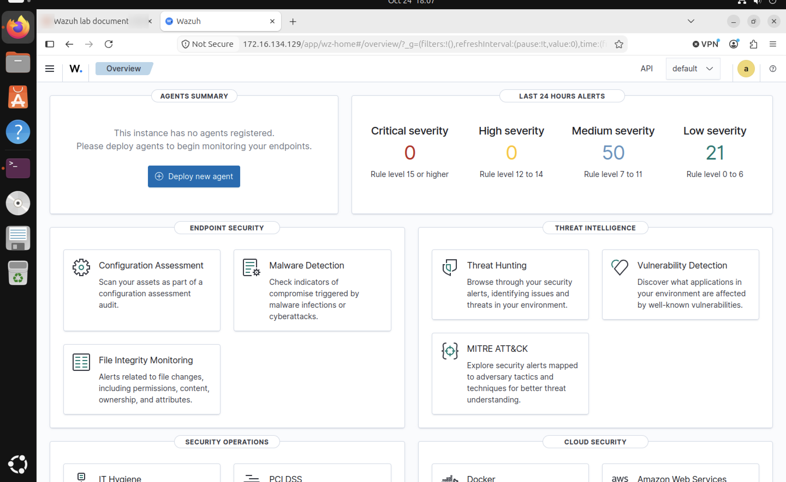
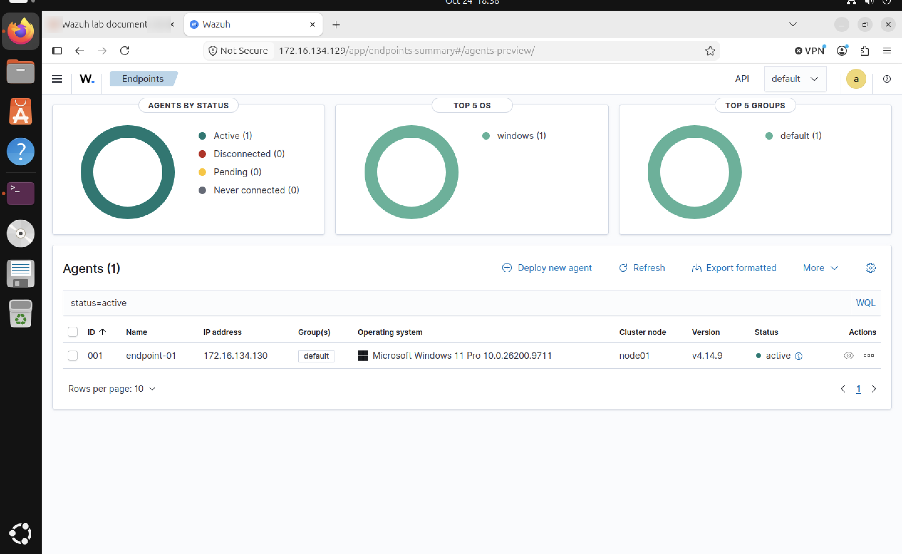
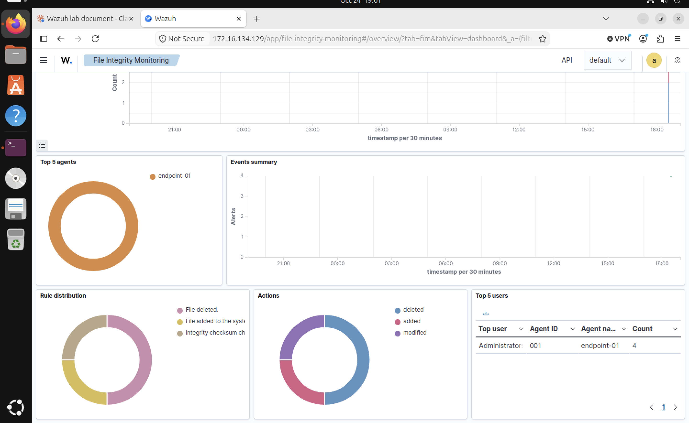
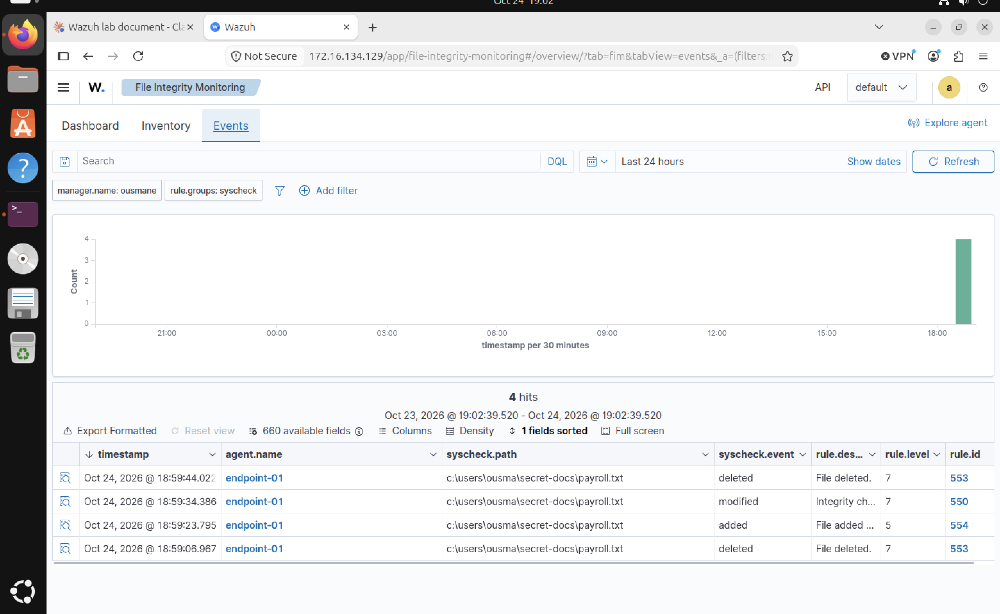
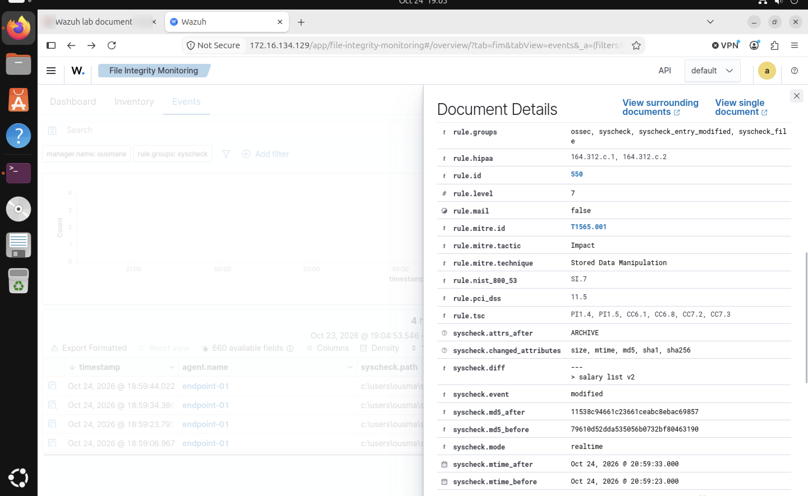
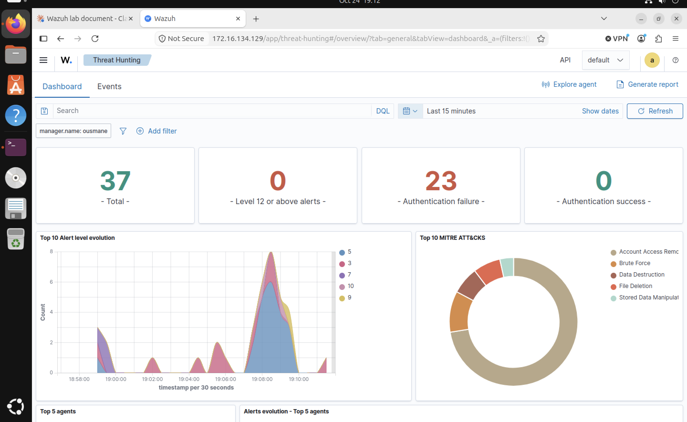
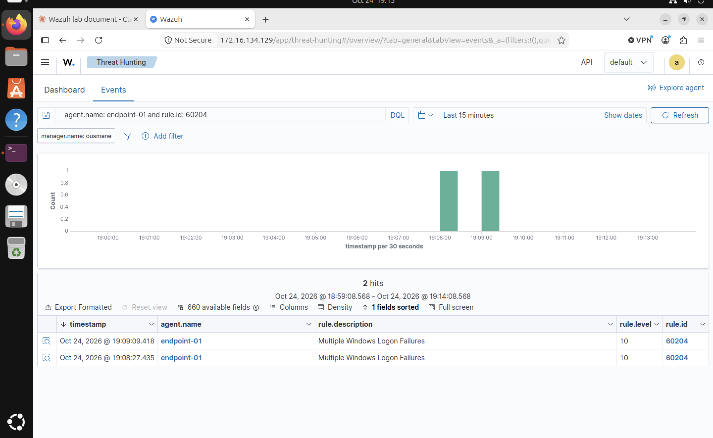
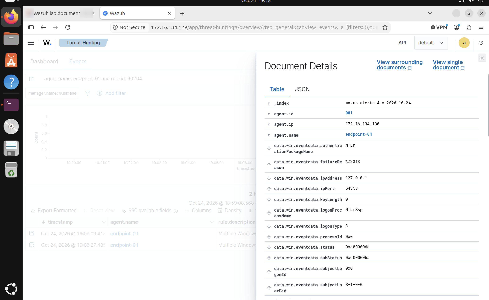

# Lab 01 — SIEM Home Lab with Wazuh (SIEM + XDR)

> Detection engineering & log analysis on a self-hosted Wazuh 4.14 stack — File Integrity Monitoring and Windows brute-force detection, investigated and written up like a SOC L1 analyst.

    

**Author:** Ousmane Cisse — MSc Computer Science (Cybersecurity), ELTE Budapest
**Series:** 5 Free Cyber Home Labs — Lab 01 / 05
**Date:** 24 October 2026

---

## Table of contents
1. [Objectives](#1-objectives)
2. [Architecture](#2-architecture)
3. [Build steps](#3-build-steps)
4. [Detection 1 — File Integrity Monitoring](#4-detection-1--file-integrity-monitoring-fim)
5. [Detection 2 — Windows brute force](#5-detection-2--windows-brute-force)
6. [Incident note](#6-incident-note-ir-2026-001)
7. [Lessons learned](#7-lessons-learned--troubleshooting)
8. [Next steps](#8-next-steps)
9. [Skills demonstrated](#9-skills-demonstrated)

---

## 1. Objectives
- Deploy a single-node Wazuh SIEM (server + indexer + dashboard).
- Enrol a Windows 11 endpoint with the Wazuh agent.
- Configure **real-time File Integrity Monitoring** with content diffs.
- Simulate a **credential brute-force attack** and investigate the resulting correlation alert.
- Map every detection to **MITRE ATT&CK** and document it as an incident note.

## 2. Architecture

```
            VMware NAT network 172.16.134.0/24 (isolated lab)
 ┌──────────────────────────────┐        ┌──────────────────────────────┐
 │ wazuh-mgr  172.16.134.129    │ 1514/  │ endpoint-01  172.16.134.130  │
 │ Ubuntu 24.04 · 4 vCPU · 8 GB │◄─1515──│ Windows 11 Pro · 4 GB        │
 │ Wazuh server+indexer+dash    │  TCP   │ Wazuh agent 4.14.9 (ID 001)  │
 └──────────────┬───────────────┘        └──────────────────────────────┘
                │ HTTPS 443
          Analyst browser
```

| Component | Details |
|---|---|
| Hypervisor | VMware Fusion, NAT network |
| Manager | Ubuntu 24.04 LTS, Wazuh 4.14 all-in-one |
| Endpoint | Windows 11 Pro (10.0.26200), agent v4.14.9 |
| Ports | 1514/TCP (events), 1515/TCP (enrolment), 443/TCP (dashboard) |

## 3. Build steps

### 3.1 Install Wazuh central components (wazuh-mgr)
```bash
curl -sO https://packages.wazuh.com/4.14/wazuh-install.sh
sudo bash ./wazuh-install.sh -a
# disable the repo so apt upgrade can't break the stack
sudo sed -i "s/^deb /#deb /" /etc/apt/sources.list.d/wazuh.list && sudo apt update
```
Dashboard: `https://172.16.134.129` → login as `admin`.



### 3.2 Enrol the Windows endpoint
Dashboard → *Agents management → Deploy new agent → Windows MSI*, then in an elevated PowerShell:
```powershell
Invoke-WebRequest -Uri https://packages.wazuh.com/4.x/windows/wazuh-agent-4.14.9-1.msi -OutFile $env:tmp\wazuh-agent
msiexec.exe /i $env:tmp\wazuh-agent /q WAZUH_MANAGER='172.16.134.129' WAZUH_AGENT_NAME='endpoint-01'
NET START Wazuh
```
Result: agent **001 · endpoint-01 · active**.



## 4. Detection 1 — File Integrity Monitoring (FIM)

**Config** — `C:\Program Files (x86)\ossec-agent\ossec.conf`, inside `<syscheck>`:
```xml
<directories realtime="yes" check_all="yes" report_changes="yes">C:\Users\ousma\secret-docs</directories>
```

**Simulation:**
```powershell
Restart-Service WazuhSvc
Set-Content C:\Users\ousma\secret-docs\payroll.txt "salary list v1"   # add
Add-Content C:\Users\ousma\secret-docs\payroll.txt "salary list v2"   # modify
Remove-Item C:\Users\ousma\secret-docs\payroll.txt                    # delete
```

**Results:**

| Time (CEST) | Event | Rule | Level | Description |
|---|---|---|---|---|
| 18:59:23 | added | 554 | 5 | File added to the system |
| 18:59:34 | modified | 550 | 7 | Integrity checksum changed |
| 18:59:44 | deleted | 553 | 7 | File deleted |

**Key fields from the `modified` alert:**

| Field | Value |
|---|---|
| `syscheck.diff` | `> salary list v2` — exact content change captured |
| `syscheck.changed_attributes` | size, mtime, md5, sha1, sha256 |
| `syscheck.md5_before → md5_after` | `79610d52…` → `11538c94…` |
| `syscheck.mode` | realtime |
| `rule.mitre` | **T1565.001** Stored Data Manipulation (Impact) |
| Compliance | PCI DSS 11.5 · HIPAA 164.312.c · NIST 800-53 SI.7 |





Script: [`scripts/fim_test.ps1`](scripts/fim_test.ps1) · Config: [`config/agent/ossec.conf.windows.snippet`](config/agent/ossec.conf.windows.snippet)

## 5. Detection 2 — Windows brute force

**Simulation** (24 failed network logons in ~30 s, one valid + one non-existent account):
```powershell
for ($i=1; $i -le 12; $i++) {
  net use \\127.0.0.1\IPC$ /user:fakeuser WrongPass$i 2>$null
  net use \\127.0.0.1\IPC$ /user:ousma    WrongPass$i 2>$null
  Start-Sleep 2
}
```

**Detection chain:**

| Rule | Level | Meaning | MITRE |
|---|---|---|---|
| 60122 | 5 | Logon failure – unknown user or bad password (Event 4625) ×23 | — |
| **60204** | **10** | **Multiple Windows logon failures** (correlation) ×2 | **T1110 Brute Force** |
| lockout | 9 | Valid account locked out after threshold | T1531 Account Access Removal |

**Investigating the 60204 alert:**

| Field | Value | Analyst interpretation |
|---|---|---|
| `data.win.eventdata.ipAddress` | 127.0.0.1 | Attack originated **on the host itself** |
| `logonType` | 3 | Network logon (SMB) — not interactive (2) or RDP (10) |
| `authenticationPackageName` | NTLM | NTLM over SMB — typical of spraying tools |
| `failureReason` | %%2313 | Unknown user name or bad password |
| `status` | 0xC000006D | Generic logon failure |
| `subStatus` | **0xC000006A** | **Valid username, wrong password** → attacker has a real account name |
| `subStatus` for `fakeuser` attempts | 0xC0000064 | Username does not exist |
| Authentication success (4624) | **0** | No successful logon → attempt, not compromise |





Script: [`scripts/simulate_windows_bruteforce.ps1`](scripts/simulate_windows_bruteforce.ps1)

## 6. Incident note (IR-2026-001)

Full version: [`docs/06-incident-note-IR-2026-001.md`](docs/06-incident-note-IR-2026-001.md)

```
What:    Wazuh rule 60204 "Multiple Windows Logon Failures" (lvl 10), MITRE T1110 Brute Force –
         23 x Event 4625 (rule 60122) in ~1 min, NTLM, logon type 3 (network/SMB).
When:    24 Oct 2026, 19:08:27 – 19:09:09 CEST
Source:  127.0.0.1 (local origin)
Host:    endpoint-01 (172.16.134.130, Windows 11 Pro, agent 001)
         Targets: ousma – VALID account (SubStatus 0xC000006A), subsequently locked out (T1531);
                  fakeuser – non-existent (SubStatus 0xC0000064)
Verdict: TRUE POSITIVE – authorised lab simulation. No 4624 success after the failures → no compromise.
Actions: (prod) identify the local process behind 127.0.0.1 (malware / lateral-movement check),
         reset + unlock ousma, review lockout policy and restrict NTLM.
```

## 7. Lessons learned & troubleshooting

| Issue | Cause | Fix / lesson |
|---|---|---|
| `ping -c` failed on endpoint | Windows uses `-n`, not `-c` | Know both OS toolsets |
| Agent installed but `Stopped` | Silent MSI install doesn't start the service | `NET START Wazuh` |
| `Test-Path` returned False | Wrong profile folder (`ousmane` vs `ousma`) | Verify with `ls C:\Users` before configuring paths |
| First FIM run only logged `deleted` | Events fired while the agent was restarting / baselining | Wait ~1 min after restart before testing |
| `syscheck.mtime` 2 h ahead of alert time | Endpoint clock in wrong timezone | **Check clock skew before building an incident timeline**; sync NTP/timezone |
| Valid account locked out | Windows 11 default lockout threshold (10 attempts) | Lockout itself is a detection signal (T1531) and a DoS risk |

## 8. Next steps
- [ ] Enable **Vulnerability Detection** and review the endpoint CVE list.
- [ ] Write a custom rule in `local_rules.xml` raising severity when `secret-docs` is touched.
- [ ] Repeat the brute force from a Kali VM over the network (non-local source IP) and via RDP (logon type 10).
- [ ] Add **Sysmon** to the Windows agent for process-level visibility (who generated the 127.0.0.1 logons).
- [ ] Configure an active response to block the source IP after rule 60204.

## 9. Skills demonstrated
`SIEM deployment` · `Wazuh agent management` · `File Integrity Monitoring` · `Windows Security Event Log (4625/4740)` · `Alert triage & correlation` · `MITRE ATT&CK mapping` · `Incident documentation` · `PowerShell` · `Linux administration` · `Compliance mapping (PCI DSS / HIPAA / NIST)`

**Resume line:**
> Deployed a Wazuh 4.14 SIEM/XDR on Ubuntu with a Windows 11 endpoint; configured real-time File Integrity Monitoring with content diffs and investigated Windows brute-force correlation alerts (Event 4625, MITRE T1110), producing a documented incident note.

---

### Repository layout
```
wazuh-lab-01/
├── README.md                          ← results of the Windows run (this page)
├── docs/
│   ├── 01-install.md                  ← install the manager + dashboard
│   ├── 02-agent-enrolment.md          ← Linux agent enrolment
│   ├── 03-fim.md                      ← Linux FIM
│   ├── 04-ssh-bruteforce.md           ← Linux / SSH brute-force track (rule 5712)
│   ├── 05-troubleshooting.md
│   └── 06-incident-note-IR-2026-001.md ← Windows brute-force incident note
├── config/
│   ├── agent/ossec.conf.snippet           ← Linux agent FIM
│   ├── agent/ossec.conf.windows.snippet   ← Windows agent FIM (this run)
│   └── manager/local_rules.xml            ← custom SSH brute-force rule 100100
├── scripts/
│   ├── fim_test.ps1 / fim_test.sh
│   └── simulate_windows_bruteforce.ps1 / simulate_ssh_bruteforce.sh
└── screenshots/                       ← evidence from the 24 Oct 2026 run
```

### Alternative track: Linux endpoint + SSH brute force
Prefer an Ubuntu endpoint? Follow [`docs/02`](docs/02-agent-enrolment.md) → [`docs/03`](docs/03-fim.md) → [`docs/04`](docs/04-ssh-bruteforce.md): same FIM rules (554/550/553) and SSH brute force detected by rules 5710/5760 → **5712/5763** (T1110), plus a custom rule (`100100`) in `config/manager/local_rules.xml`.

> ⚠️ All activity was performed on isolated virtual machines I own. No credentials appear in this repository or its screenshots; no real data was used.

## License
MIT — see [`LICENSE`](LICENSE).
